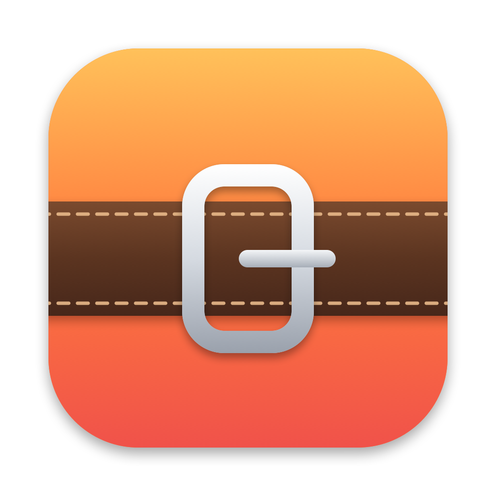

<p align="center"></p>

# Mac Belt

**Small Mac tools in one menu bar icon. Free and open source. No paid tier, no tracking, no account.**

🌐 [animesh0764.github.io/mac-belt](https://animesh0764.github.io/mac-belt/)

Mac Belt is a utility belt for your Mac: a set of small "gadgets" you switch on or off from one menu bar icon. A gadget that's off uses no CPU and asks for no permissions.

```bash
git clone https://github.com/Animesh0764/mac-belt.git && cd mac-belt && make install
```

Needs macOS 14+ and Xcode or the Command Line Tools (`xcode-select --install`).

---

## Gadgets

| Gadget | In one line | Instead of |
|---|---|---|
| ☕ [Awake](#-awake) | Keep your Mac from sleeping, for as long as you want. | Amphetamine, Lungo |
| 📋 [Clipboard](#-clipboard) | Clipboard history that wipes passwords and OTPs by itself. | Paste, Maccy |
| 🎙 [Mic Mute](#-mic-mute) | One shortcut mutes your mic in every app. | Mic Drop, MuteMe |
| 📥 [Drop Shelf](#-drop-shelf) | Shake while dragging files to park them on a shelf. | Dropover, Yoink |
| 🔤 [Text Grab](#-text-grab) | Copy text from anything on screen, even images and videos. | TextSniper |

Turn gadgets on or off in **menu ▸ Gadgets…**. Each one's options live in its menu section and in **Settings**.

### ☕ Awake

**What it is:** Stops your Mac from going to sleep while you're downloading, presenting, running a long build, or just reading. When the time's up, your Mac goes back to its normal sleep settings.

**How to use it**
- **Turn On** keeps the Mac awake until you turn it off.
- **Keep Awake For** sets a timer: 15 min, 30 min, 1 h, 2 h, 3 h or 8 h. The running one has a tick.
- **Stay Awake While App Runs** keeps the Mac awake only while an app you pick is open, such as a video call or a game.
- **Options ▸ Keep the screen on too** stops the display dimming as well. Off means the screen may turn off but the Mac keeps working.
- **Options ▸ Only when plugged in** never keeps the Mac awake on battery.
- The menu bar icon shows a ☀️ while Awake is on.

**Permissions:** none.

### 📋 Clipboard

**What it is:** Remembers what you copy so you can paste it again later, and searches it. Unlike other clipboard managers, it spots **OTPs, API keys, passwords and private keys**. It keeps them in memory only, never on disk, and wipes them after 60 seconds from both the history and the clipboard. Copies from password managers (1Password, Bitwarden, Keychain…) are never recorded at all.

**How to use it**
- Press **⌃⌘V** to open the history. Type to search.
- **↑ ↓** to pick, **↩** to paste it into the app you're in, **⌥↩** to just copy it, **⌘1–9** for the first nine.
- **⌘P** pins an item so it's never cleaned up, and **⌘⌫** deletes one.
- **Pause Saving History** stops recording for a while, for example during a screen share.
- **Ignored Apps**: tick an app and nothing you copy in it is saved.
- History keeps 300 items for 30 days by default. Change both in Settings, along with whether images are saved.

**Permissions:** *Paste from Other Apps* (macOS 15.4+; see [setup](#clipboard-one-time-setup)). *Accessibility* only if you want ↩ to paste directly into the app you're in.

### 🎙 Mic Mute

**What it is:** Mutes your microphone itself, not just one app, so it works in Zoom, Meet, Teams, Discord, Slack and the browser at once. A red **Muted** sign stays on screen so you never talk into a muted mic or forget you're live.

**How to use it**
- Press **⌃⌥M** anywhere to mute or unmute, or use the menu.
- Click the red sign to unmute. The menu bar icon becomes a crossed-out mic while muted.
- Switch mics, for example when AirPods connect, and you stay muted.
- **Options** moves the sign to the top or bottom of the screen, or hides it.
- Turning the gadget off or quitting Mac Belt always unmutes, so the mic is never left muted with no sign.

**Permissions:** none.

### 📥 Drop Shelf

**What it is:** A floating shelf for files that are in the middle of a move. Drag files from one place, park them on the shelf, go find where they belong, and drag them off again. No more juggling two Finder windows.

**How to use it**
- Start dragging files and **shake the cursor left-right** a few times. The shelf pops up next to the cursor. Drop the files on it.
- Or press **⌃⌥S** to show or hide the shelf.
- Drag files off one at a time, or use **Drag all** to take them all at once.
- The shelf holds references, not copies. Dragging out to another folder moves the file, like in Finder (hold ⌥ to copy). **✕** empties the shelf and never touches your files.

**Permissions:** none.

### 🔤 Text Grab

**What it is:** Copies the text out of anything you can see: screenshots, images, videos, PDFs that won't let you select text, error dialogs, someone's shared screen. Draw a box and the text is on your clipboard. It reads QR codes and barcodes too. All of it happens on your Mac using Apple's built-in text recognition, and nothing is uploaded.

**How to use it**
- Press **⌃⌥T** (or **Grab Text…** in the menu). The screen freezes, so text in a playing video stays put. Drag a box over the text.
- **Esc** cancels.
- A note confirms what was copied, for example "Copied 42 words" or "Copied link from QR code".
- **Options ▸ Keep line breaks**: on keeps lines as they look. Off joins each paragraph into one line, which is handy for PDFs and slides.
- **Options ▸ Read QR codes and barcodes** can be turned off.

**Permissions:** *Screen Recording*, so Mac Belt can see what's inside the box. The frozen screenshot stays in memory and is never saved.

## Install

### From source (recommended)

```bash
git clone https://github.com/Animesh0764/mac-belt.git
cd mac-belt
make install      # builds, copies Mac Belt to ~/Applications, opens it
```

Then look for the 🔧 icon in your menu bar. To start it at login: **Settings ▸ Open Mac Belt at login**.

| Command | Does |
|---|---|
| `make update` | `git pull` + reinstall |
| `make uninstall` | remove the app (keeps settings; `PURGE=1` removes them too) |
| `make test` | run the tests |
| `make run` | build and open without installing |

### Homebrew

```bash
brew tap Animesh0764/tap
brew trust --formula Animesh0764/tap/mac-belt   # Homebrew asks you to trust non-official taps
brew install mac-belt
mac-belt                                        # copies it to ~/Applications and opens it
```

This builds from source on your Mac too. Run `mac-belt` again after each `brew upgrade mac-belt` to refresh the copy in ~/Applications. To remove it: `mac-belt uninstall && brew uninstall mac-belt`.

Homebrew itself officially supports macOS 15 (Sequoia) and newer, and needs up-to-date Command Line Tools to build from source. On macOS 14, use `make install`.

### Why build from source?

Mac Belt is free, so it isn't signed with a paid Apple Developer ID. Apps you build yourself aren't blocked by Gatekeeper, and you can read every line before you run it.

#### About the "Mac Belt Local" certificate

macOS remembers permissions (Accessibility, Screen Recording…) by an app's code signature. A normal home-built app gets a new signature on every build, so macOS would ask again after every update.

`make install` and `mac-belt` therefore create a self-signed certificate called **Mac Belt Local** once and sign your build with it, so permissions survive updates. It needs no sudo and no password prompt. It's kept in its own small keychain in `~/Library/Application Support/MacBelt/signing/`, not your login keychain, and is only meaningful on your Mac. Skip it with `ADHOC=1 make install` (or `MACBELT_ADHOC=1 mac-belt`), or remove it any time:

```bash
make remove-signing-identity
```

### Clipboard: one-time setup

macOS 15.4+ asks before an app reads the clipboard in the background. After the first prompt, set **System Settings ▸ Privacy & Security ▸ Paste from Other Apps ▸ Mac Belt ▸ Allow**, or macOS will ask on every copy.

## Privacy

- Everything runs on your Mac. Mac Belt makes **no network requests**.
- Clipboard history stays in `~/Library/Application Support/MacBelt/clipboard.sqlite` (readable only by you). Detected secrets live in memory only.
- Text Grab reads text on your Mac; its screenshot is never saved to disk.
- No analytics, no crash reporting, no account.
- Settings are plain JSON in `~/Library/Application Support/MacBelt/`. Read them, edit them, delete them.
- Each gadget asks for a permission only when you switch it on, and the gallery shows which permissions each gadget needs.

## ☕ Support

Mac Belt is free and always will be. If it saved you from buying an app, consider buying me a coffee (or chai) instead:

- **Anywhere:** [GitHub Sponsors](https://github.com/sponsors/Animesh0764)
- **India (UPI):** scan the QR in the app (menu ▸ Support Mac Belt) or pay `singh.animesh.1@superyes`

Can't pay? Starring the repo, reporting a bug or telling a friend helps just as much.

## Contributing

Gadgets are small and self-contained, so each one is a good first PR. See [CONTRIBUTING.md](CONTRIBUTING.md) for how to write one.

## License

MIT
